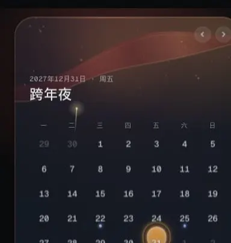

# 节日玻璃日历 · Glass Festival Calendar

点一个日期，玻璃卡片就会换一场动效。除夕点爆竹，元宵摇彩笺，七夕双鹊飞过星河，冬至霜花从玻璃边缘长开。

[下载单文件版](https://github.com/scorpionsguo1989-hash/glass-festival-calendar/releases/latest/download/glass-festival-calendar.html) · [查看版本与视频](https://github.com/scorpionsguo1989-hash/glass-festival-calendar/releases/latest)

- **20 种动效。** 18 个内置节日各有专属场景，另有生日气球和彩纸、日常青色流光。点「动效一览」可预览、重播或跳到对应日期。
- **自己的节日。** 可添加生日和纪念日，任意选择动效，按公历每年重复。同一天有多个节日时可以切换。
- **本地使用。** 下载 HTML 后用浏览器打开。网页版的设置保存在当前浏览器；不同浏览器或地址之间的设置各自独立。需要稳定保存设置时可使用下面的本地服务。

## 从源码运行

使用 Node.js 22.12 或更新版本。在仓库目录运行：

~~~bash
npm ci
npm run dev
~~~

按终端提示打开本机地址。React 负责日历交互，Canvas 2D 绘制动效。日期网格支持键盘方向键，动画遵循系统的减弱动态效果偏好。

- npm run build 生成静态网页到 dist/client。
- npm run build:offline 另外生成 dist/glass-festival-calendar.html，需要 Python 3。
- npm run generate:calendar 使用 [lunar-javascript](https://github.com/6tail/lunar-javascript) 重新生成 2026–2030 年的农历节日和节气日期。节日以本日标注。

## 来源与许可

视觉灵感来自 uberdesigner 的 [Holiday Calendar](https://uberdesigner.ai/t/holiday-calendar)。这里的日历交互、动效和演示画面独立实现。农历节日和节气日期由 lunar-javascript 计算，并与[香港天文台历法对照表](https://www.hko.gov.hk/sc/gts/time/conversion1_text.htm)交叉核对。

项目源码采用 [MIT](LICENSE)。字体和图标沿用各自的许可，见 [第三方许可](THIRD_PARTY_NOTICES.md)。
